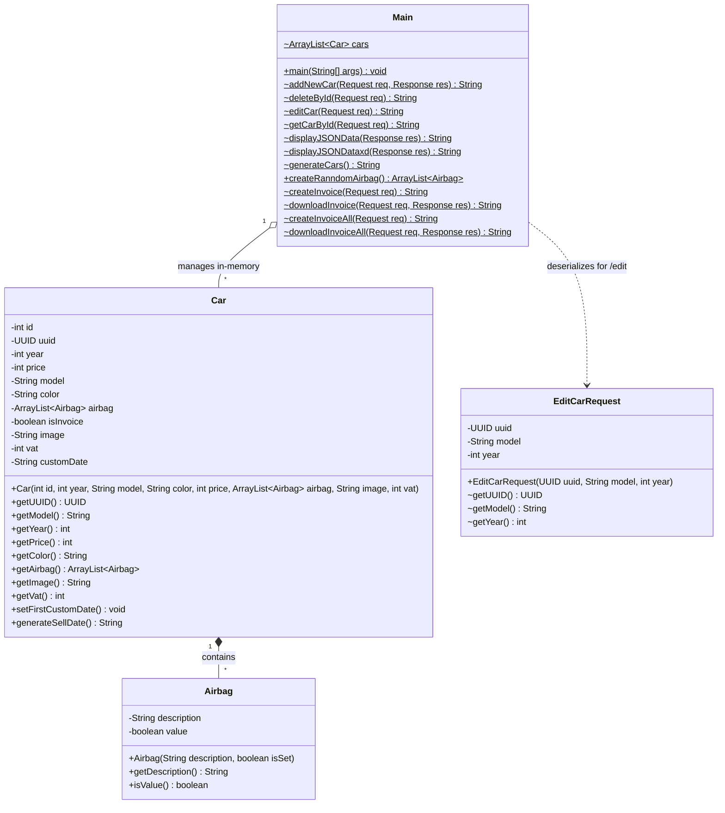

# JAVA-Spark-Cars


A lightweight full-stack car inventory and VAT PDF invoice web application built with **Java 17**, the **Spark Java** micro-framework, **Gson**, and **iText PDF**. Manage vehicle records through a vanilla HTML/CSS/JavaScript frontend backed by an in-memory REST-like API, and generate downloadable single-vehicle or fleet-wide PDF invoices on demand.

---

## Features

- **Car Inventory Management (CRUD):** Add custom vehicles with model, price, production year, color, and airbag configurations (`driver`, `passenger`, `rear bench`, `side`), edit existing records in a modal overlay, or delete vehicles by UUID.
- **Random Fleet Generator:** Populate the inventory with 10 randomized sample vehicles (`Renault`, `Audi`, `Opel`) with random pricing, VAT rates (`0%`, `7%`, `20%`), airbag configurations, brand thumbnails, and randomized sale dates.
- **Single-Car PDF Invoice Generation:** Generate a per-vehicle PDF invoice (`invoices/<uuid>.pdf`) containing the vehicle's UUID, sale date, specs, airbag breakdown, and a scaled brand image, then download it directly from the browser.
- **Batch Fleet VAT Invoice:** Generate a consolidated multi-row VAT invoice (`invoices/<unixTimestamp>invoiceall.pdf`) summarizing every car in the inventory with net price, VAT percentage, gross value per item, and total gross sum.
- **Zero-Build Static Frontend:** Served directly by Spark's embedded Jetty server from `src/main/resources/static/` using standard browser `fetch()`.

---

## Architecture & Domain Model

The backend is organized under `com.Dudek`, where `Main` acts as both the Spark HTTP router/controller and in-memory repository (`ArrayList<Car>`), serializing payloads with Gson and rendering PDFs with iText.



---

## API Endpoints

All routes are registered in `com.Dudek.Main` on port **`3000`**.

| Method | Endpoint | Request Body / Query Params | Response | Description |
| :--- | :--- | :--- | :--- | :--- |
| `POST` | `/add` | JSON `Car` (`model`, `year`, `color`, `price`, `airbag[]`) | `text/plain` | Assigns a UUID, ID, random brand image, VAT rate, and sale date, then adds the car to the inventory. |
| `GET` | `/json` | None | `application/json` | Returns the full car list formatted as pretty-printed JSON. |
| `GET` | `/json-pdf` | None | `application/json` | Returns the full car list as pretty-printed JSON (used by `cars-pdf.html`). |
| `GET` | `/generateCars` | None | `text/plain` (`"ok"`) | Appends 10 randomly generated cars (`Renault`, `Audi`, `Opel`) to the inventory. |
| `POST` | `/get` | JSON `{"uuid": "<uuid>"}` | JSON `Car` or `"nie"` | Retrieves a single car record by UUID for editing. |
| `POST` | `/edit` | JSON `EditCarRequest` (`uuid`, `model`, `year`) | `text/plain` | Updates the `model` and `year` of the matching car. |
| `POST` | `/del` | JSON `{"uuid": "<uuid>"}` | `text/plain` | Removes the matching car from the in-memory list. |
| `POST` | `/invoice` | JSON `Car` (`uuid`, `model`, `year`, `color`, `airbag[]`, `image`) | `text/plain` (`"ok"`) | Generates `invoices/<uuid>.pdf` with car metadata, airbag details, and embedded brand image. |
| `GET` | `/invoicedownload` | Query param `?uuid=<uuid>` | `application/octet-stream` | Streams `invoices/<uuid>.pdf` as a downloadable attachment (`<uuid>.pdf`). |
| `GET` | `/invoiceall` | None | `text/plain` (`<unixTime>`) | Generates `invoices/<unixTime>invoiceall.pdf` with a VAT summary table for all cars and returns the timestamp key. |
| `GET` | `/invoicedownloadall` | Query param `?uuid=<unixTime>` | `application/octet-stream` | Streams `invoices/<unixTime>invoiceall.pdf` as a downloadable attachment (`faktura-wszystkie.pdf`). |

---

## Tech Stack

| Layer | Technology |
| :--- | :--- |
| **Language** | Java 17 |
| **Web Framework** | Spark Java (`com.sparkjava:spark-core:2.9.1`) |
| **JSON Serialization** | Google Gson (`2.8.6`) |
| **PDF Generation** | iText PDF (`5.5.10`) |
| **UUID Generation** | FasterXML `java-uuid-generator` (`4.0.1`) |
| **Logging** | SLF4J API & Simple (`1.7.30`) |
| **Frontend** | Vanilla HTML5, CSS3, ES6 Fetch API |
| **Build Tool** | Apache Maven |

---

## Project Structure

```text
JAVA-Spark-Cars/
├── pom.xml                                  # Maven configuration and dependencies (Java 17)
├── invoices/                                # Runtime output directory for generated PDF invoices
└── src/
    └── main/
        ├── java/com/Dudek/
        │   ├── Main.java                    # Spark server entry point, routes, in-memory store, PDF logic
        │   ├── Car.java                     # Core vehicle domain model & random sale date generator
        │   ├── Airbag.java                  # Airbag configuration item (description + boolean flag)
        │   └── EditCarRequest.java          # DTO for car model/year edit requests
        └── resources/static/
            ├── index.html                   # Add-car form view (/)
            ├── cars.html                    # Inventory table, CRUD actions & per-car PDF invoices
            ├── cars-pdf.html                # Fleet overview & consolidated VAT PDF invoice generator
            └── images/
                ├── Audi.png                 # Brand thumbnail embedded in UI & PDFs
                ├── Opel.png                 # Brand thumbnail embedded in UI & PDFs
                └── Renault.png              # Brand thumbnail embedded in UI & PDFs
```

---

## Getting Started

### Prerequisites

- **JDK 17** or newer
- **Apache Maven 3.6+** (or an IDE with Maven support such as IntelliJ IDEA)

### Installation & Build

1. Clone the repository:

   ```bash
   git clone https://github.com/Dudek03/JAVA-Spark-Cars.git
   cd JAVA-Spark-Cars
   ```

2. Compile the project and download Maven dependencies:

   ```bash
   mvn compile
   ```

### Running the Application

Run the server from the project root directory (important so relative paths `invoices/` and `src/main/resources/static/images/` resolve properly):

```bash
mvn exec:java -Dexec.mainClass="com.Dudek.Main"
```

Alternatively, open the project in **IntelliJ IDEA** and run `com.Dudek.Main.main()`.

Once started, the application is available at:

- **`http://localhost:3000/`** — Add a new car
- **`http://localhost:3000/cars.html`** — View, generate, edit, delete cars, and create individual PDF invoices
- **`http://localhost:3000/cars-pdf.html`** — Generate a consolidated VAT PDF invoice for all cars

---

## Usage Walkthrough

1. **Add or Generate Cars:**
   - Open `http://localhost:3000/` to submit a custom car via the form (`model`, `price`, `year`, airbag checkboxes, and `color`).
   - Or navigate to `/cars.html` and click **`generuj auta`** to instantly add 10 randomized vehicles.
2. **Edit or Delete Records:**
   - On `/cars.html`, click **`edit`** on any row to open the modal editor for `model` and `year`, or click **`delete`** to remove the car.
3. **Generate Individual PDF Invoices:**
   - On `/cars.html`, click **`invoice`** on any vehicle row to render `invoices/<uuid>.pdf` on the server; a **`download`** link appears immediately in the row.
4. **Generate a Fleet VAT Invoice:**
   - Navigate to `/cars-pdf.html` and click **`generuj fakture`** to compile a VAT invoice table covering every vehicle currently in memory, then click **`pobierz fakture`** to download `faktura-wszystkie.pdf`.

> [!NOTE]
> Vehicle records are stored in memory (`ArrayList<Car>`) and reset when the server restarts. Generated PDF files are persisted locally inside the `invoices/` directory.
